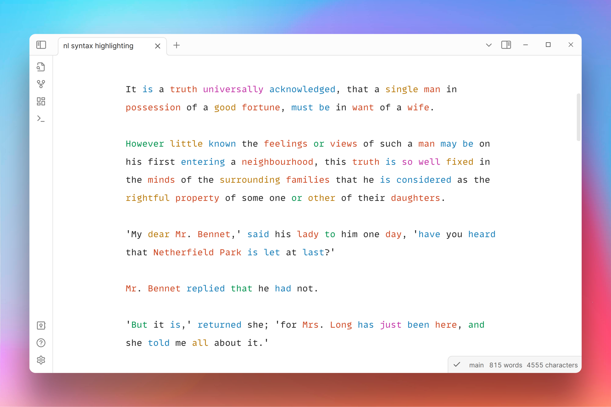
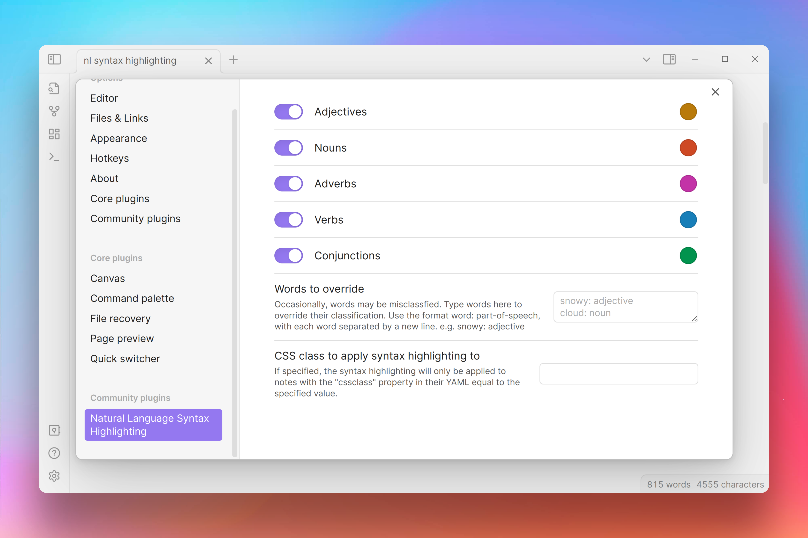

# Natural Language Syntax Highlighting

A plugin for [Obsidian.md](https://obsidian.md/) that highlights adjectives, nouns, adverbs, verbs, and conjunctions in the editor. Inspired by iA Writer.

Colours can be customised in the plugin settings.

The language of the text can be selected in the plugin settings under **Language**: English is processed with [compromise](https://github.com/spencermountain/compromise), German with [de-compromise](https://github.com/nlp-compromise/de-compromise).

The highlighting can be toggled on or off at any time via the command **Natural Language Syntax Highlighting: Toggle on/off** in the Command palette.

Multilanguage support includes:
- English
- German (beta)

## Contributing

Any contributions and PRs are welcome.

## Acknowledgements

This plugin uses the [compromise](https://github.com/spencermountain/compromise) natural language processing library to detect parts of speech in English, and [de-compromise](https://github.com/nlp-compromise/de-compromise) for German.
